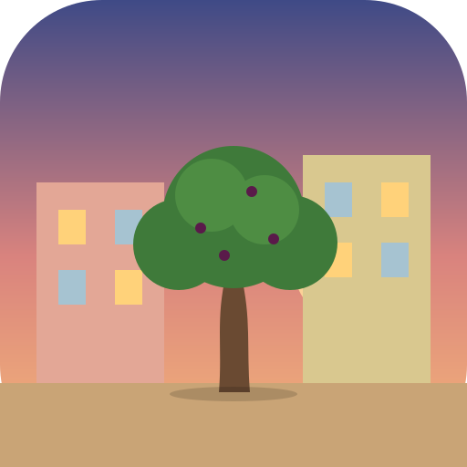
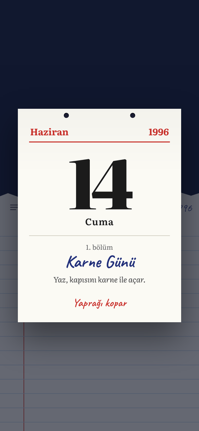
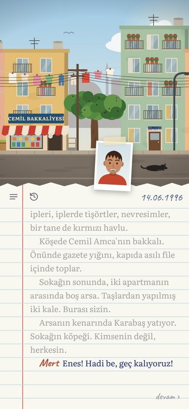
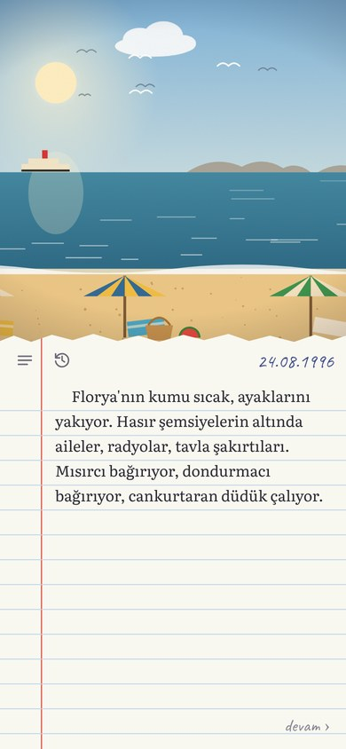
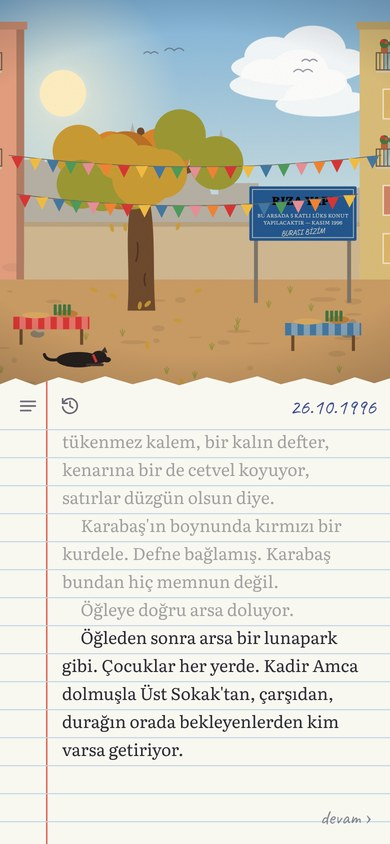
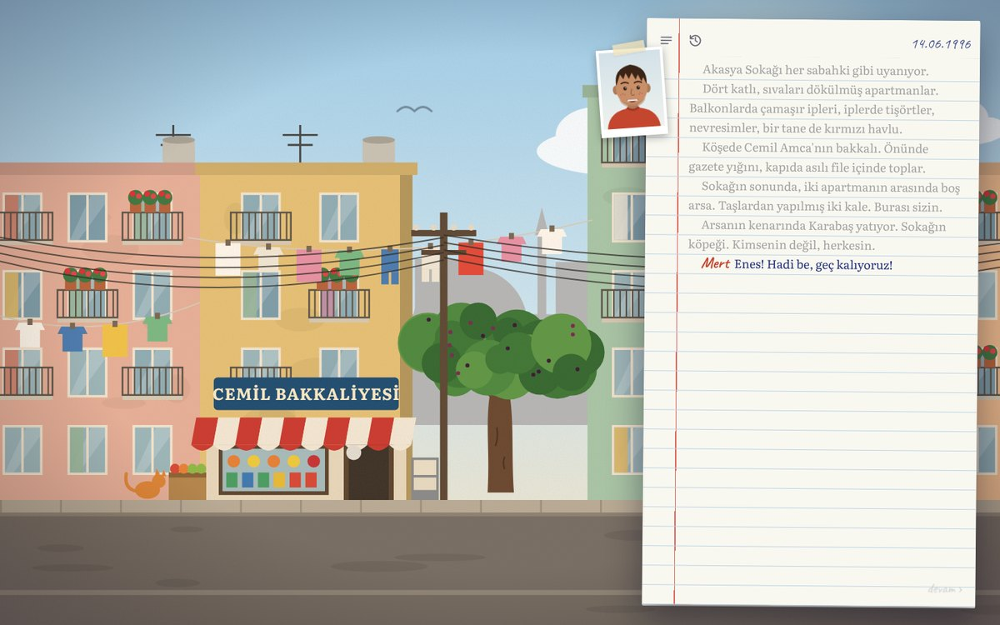

<div align="center">



# Mahalle

**1996 yazı. Akasya Sokağı. Bir boş arsa, bir dut ağacı ve dört ay.**

Seçimlerinle ilerleyen, birden çok sonu olan bir hikaye oyunu.
Telefonda, bilgisayarda ve tarayıcıda oynanır.

[](https://github.com/Enskygr234/mahalle/releases/latest/download/Mahalle.apk)
[](https://github.com/Enskygr234/mahalle/releases/latest/download/Mahalle-Windows.exe)
[](https://enskygr234.github.io/mahalle/)

   

</div>

## Hikaye

Okulların kapandığı gün Akasya Sokağı'na Almanya plakalı bir minibüs giriyor. Aynı yaz, çocukların top oynadığı arsaya mavi bir tabela dikiliyor: *"Bu arsada 5 katlı lüks konut yapılacaktır. Kasım 1996."*

Haziran'dan Kasım'a kadar, karne gününden ilk yağmura kadar, sokağın çocuklarından biri sensin. En yakın arkadaşın Mert, yeni gelen Defne, bakkal Cemil Amca, balkondan sepet sarkıtan Nermin Teyze, askere gidecek Hasan Abi ve sokağın köpeği Karabaş. Kime yardım edeceğin, kime ne söyleyeceğin, kimin yanında duracağın sokağın kaderini değiştiriyor.

- **6 bölüm ve bir son söz**, her biri bir takvim yaprağıyla açılıyor
- **5 farklı son**, seçimlerine ve kurduğun dostluklara göre
- **Anı defteri:** Defne'nin makinesinden 27 fotoğraf, başka seçimlerde saklı olanlar da var
- Günün saatine, mevsime ve havaya göre değişen sahneler
- Kuş sesleri, cırcır böcekleri, yağmur; hepsi oyunun içinde üretiliyor
- Bir oynanış yaklaşık 45 dakika, bütün sonlar için birkaç saat

<div align="center">

</div>

## Kurulum

**Android:** [Mahalle.apk](https://github.com/Enskygr234/mahalle/releases/latest/download/Mahalle.apk) dosyasını indir ve aç. Telefon "bilinmeyen kaynak" uyarısı verirse izin ver.

**Windows:** [Mahalle-Windows.exe](https://github.com/Enskygr234/mahalle/releases/latest/download/Mahalle-Windows.exe) dosyasını indir ve çift tıkla. Kurulum gerekmez. SmartScreen uyarı verirse *Ek bilgi → Yine de çalıştır*. Tam ekran için F11.

**Tarayıcı:** [enskygr234.github.io/mahalle](https://enskygr234.github.io/mahalle/)

Oyun her adımda kendiliğinden kaydedilir; kapatıp açtığında kaldığın yerden devam edersin.

## Kontroller

| | |
|---|---|
| Dokun / tıkla, Boşluk, Enter | Devam |
| 1, 2, 3, 4 | Seçim yap |
| Esc | Menü |

## Geliştirme

Hiçbir çerçeve kullanılmadı: düz HTML, CSS ve JavaScript. Sahneler ve portreler kodla çizilen SVG'ler, sesler Web Audio ile üretiliyor.

```
www/
  hikaye/     bölümlerin metinleri (kendi küçük betik dilinde)
  js/sahne.js sokak, arsa, bakkal ve diğer sahneleri çizer
  js/portre.js karakterlerin vesikalıkları
  js/motor.js betiği okur, sayfaya yazar, seçimleri yönetir
  js/ses.js   ortam sesleri ve efektler
```

Tarayıcıda denemek için `www/index.html` dosyasını açman yeterli. `v` ile başlayan bir etiket gönderildiğinde GitHub Actions APK'yı (Capacitor) ve Windows sürümünü (Electron) derleyip sürüm olarak yayınlar.

Yazı tipleri: [Literata](https://github.com/googlefonts/literata) ve [Caveat](https://github.com/googlefonts/caveat), SIL Open Font License.

<div align="center">

*Bir ağacı kimse dikmez; hep beraber büyütülür.*

</div>
